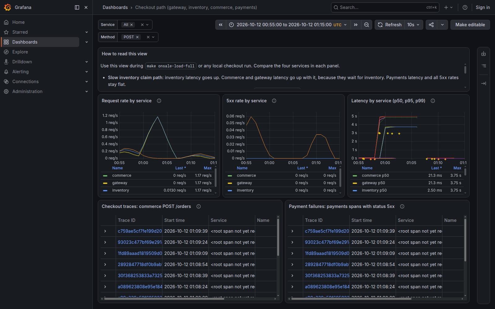

# Checkout-path dashboard (TKT-337)

One saved Grafana view of the checkout path. It compares request rate, 5xx rate and latency of
the gateway, inventory, commerce and payments, and it opens real traces. Use it during
`make onsale-load-full` or any local checkout run to see which service is slow or failing.

This is **local Compose evidence**. It is not a production capacity proof, and it does not
change the TKT-82 throughput verdict (`docs/evidence/TKT-82/full-profile.json` is not
regenerated by this ticket). The dashboard panels have no thresholds. One local demo alert rule
(TKT-338) uses the 5xx query; see [Checkout-path 5xx alert](#checkout-path-5xx-alert-tkt-338). It
is not a production paging threshold, and nothing alerts on the parked-order gauges (ADR-065).

## Where it is

| Item | Value |
|---|---|
| Dashboard JSON | `deploy/grafana/dashboards/checkout-path.json` |
| Provider | `deploy/grafana/provisioning/dashboards/checkout-path.yaml` |
| Alert rule (TKT-338) | `deploy/grafana/provisioning/alerting/checkout-5xx.yaml`, rule UID `ticketing-checkout-5xx` |
| Mounts | `compose.yaml`, service `lgtm` (three read-only mounts) |
| UID | `ticketing-checkout-path` |
| URL, dev stack (`make up`) | `http://localhost:3000/d/ticketing-checkout-path` |
| URL, smoke stack | `http://localhost:${GRAFANA_PORT}/d/ticketing-checkout-path` (`scripts/stack-env.sh` prints the slot) |
| Datasources | Prometheus uid `prometheus`, Tempo uid `tempo` (provisioned by the `grafana/otel-lgtm` image) |
| Access | Anonymous (the image enables it). No password is needed or stored. |

Base `compose.yaml` publishes only the gateway. Grafana is on the host only with
`compose.direct-ports.yaml`, which `make up`, `scripts/smoke.sh` and `scripts/browser.sh` add.

Grafana refuses to save a change to this dashboard (`allowUiUpdates: false`). To change it,
edit the JSON file. Grafana reads the file again within 10 seconds.

## Panels and queries

Variables: `service` (gateway, inventory, commerce, payments; default All) and `method`
(default `POST`). The `POST` default keeps out the health probes, which every service records
as `GET /healthz` every 5 seconds.

All Prometheus panels use the OpenTelemetry server histogram
`http_server_request_duration_seconds` (seconds) and this selector:

```promql
service_name=~"${service:regex}",http_request_method=~"${method:regex}",http_route=~"/api/(inventory|commerce|payments)/|"
```

The route matcher keeps the gateway's checkout prefixes. The empty alternative (`|"`) also keeps
series that have no `http_route` label, which is every inventory, commerce and payments series.
This was executed before it was committed: [without](../../evidence/TKT-337/route-clause/without-route-clause.json)
and [with](../../evidence/TKT-337/route-clause/with-route-clause.json) the matcher. It removes the
gateway's `/api/catalog/` and `/healthz` series and keeps all the others.

| Panel | Query |
|---|---|
| Request rate by service | `sum by (service_name) (rate(http_server_request_duration_seconds_count{<selector>}[$__rate_interval]))` |
| 5xx rate by service | `sum by (service_name) (rate(…_count{<selector>,http_response_status_code=~"5.."}[$__rate_interval])) or on (service_name) 0 * sum by (service_name) (rate(…_count{<selector>}[$__rate_interval]))` |
| Latency by service (p50, p95, p99) | `histogram_quantile(q, sum by (service_name, le) (rate(http_server_request_duration_seconds_bucket{<selector>}[$__rate_interval])))`, exemplars on |
| Checkout traces: commerce POST /orders | TraceQL `{resource.service.name="commerce" && span.http.request.method="POST" && span.url.path="/orders"}` |
| Payment failures: payments spans with status 5xx | TraceQL `{resource.service.name="payments" && span.http.response.status_code >= 500}` |

## How to tell a slow inventory claim from a payment failure

| Symptom | Slow inventory claim path | Payment failure |
|---|---|---|
| Latency | inventory goes up; commerce and gateway go up too, because they wait for inventory | flat |
| Payments latency | flat | flat |
| 5xx rate | flat | payments goes up |
| Commerce and gateway 5xx | 0 | 0, because commerce answers `202 payment_unknown` |

### Observed result

`smoke/checkout_dashboard_induced_test.go` induces both failures and records what the panels
show. Grafana evaluated each panel query; the values below come from those results.

**Run with the full on-sale profile** (`docs/evidence/TKT-337/onsale-full/`):

| Service | p95 before (s) | p95 max, slow phase (s) | 5xx max, slow phase (req/s) | 5xx max, payment phase (req/s) | 5xx max, whole run (req/s) |
|---|---|---|---|---|---|
| gateway | 0.068 | 4.875 | 0 | 0 | 0 |
| inventory | 0.021 | 4.875 | 0 | 0 | 0 |
| commerce | 0.068 | 4.875 | 0 | 0 | 0 |
| payments | 0.022 | 0.023 | 0 | 0.030 | 0.030 |

Phases (UTC, 2026-10-12): slow inventory 01:32:51–01:36:55 (69 rounds, 277 reservations, each
3.02–3.08 s at the client), payment failure 01:41:56–01:43:41 (8 checkouts), run end 01:48:42.
`TestOnsaleLoadProof` started after this run ended. So the induced example ran in the same smoke
run as the full profile, but before its load, not under it. The p95 value 4.875 s is the
interpolation inside the 2.5–5 s histogram bucket.

On this host (WSL2, 16 CPUs, other Compose stacks running), `TestOnsaleLoadProof`'s full profile
did not give a verdict in any of the three runs:

- In each run, a sweep stage ended inconclusive (client transport errors) or unstable. The same
  thing occurred on an unchanged copy of `c16ef536`, so the sweep failures are a property of the
  host, not of this ticket.
- In one run, the NFR window also failed its accounting check: 27001 `claim_history` inserts,
  27000 expected. That run was before the gate test cleaned up its `payment_unknown` orders. The
  probable cause is that the recovery runner released those orders inside the measured window.
  The cleanup was added for this reason, and the next run counted exactly 27000. The cause is
  probable, not proven.

The TKT-82 report of these runs went to a scratch file and is not evidence here.

**Run on a kept-up smoke stack** (`docs/evidence/TKT-337/kept-up-run/`, the same test and compose
files; this run also has a screenshot):

| Service | p95 before (s) | p95 max, slow phase (s) | 5xx max, payment phase (req/s) | 5xx max, whole run (req/s) |
|---|---|---|---|---|
| gateway | 0.066 | 4.875 | 0 | 0 |
| inventory | 0.009 | 4.875 | 0 | 0 |
| commerce | 0.066 | 4.875 | 0 | 0 |
| payments | 0.021 | 0.021 | 0.034 | 0.034 |

Slow phase: 72 rounds, 289 reservations, each 3.02–3.10 s at the client. The p95 value 4.875 s
is the interpolation inside the 2.5–5 s histogram bucket.



The screenshot covers 00:55–01:15 UTC. Latency of inventory, commerce and gateway rises to the
2.5–5 s bucket during the slow phase (00:59–01:03), and payments stays near 20 ms. The payments
5xx rate rises during the payment phase (01:08–01:10), and the other services stay at 0. The
earlier payments 5xx peak (00:55–00:58) comes from gate-test runs before this run.

## Trace drill-down

The view opens a real trace in two ways:

1. **Traces tables.** Click a trace ID in "Checkout traces" or "Payment failures". Grafana opens the
   trace in Explore, with all its spans. The rendered tables link each trace ID to
   `/explore?left={"datasource":"tempo","queries":[{"query":"<trace ID>",…}]}`, and the gate test
   proves that the query returns the test's own checkout and that Tempo returns its spans.
2. **Latency panel, exemplar.** Each latency series has exemplar points (diamonds, see the
   screenshot). Point to one, then click the trace link. The image's Prometheus datasource links the
   `trace_id` exemplar label to the Tempo datasource. In the plan review, 82 of 109 trace IDs that a
   Tempo search returned were also exemplar trace IDs, so exemplars name real traces. Nobody clicked
   an exemplar link in a browser for this ticket.

Two real traces, from the full-profile run:

| Phase | Trace ID | Server spans (duration) |
|---|---|---|
| Slow inventory | `f03ff6dbce43b5355aab92012f5d55cf` | gateway `POST /api/commerce/reservations` 3.045 s → commerce `POST /reservations` 3.044 s → inventory `POST /holds` 3.035 s (201) |
| Payment failure | `352750871b126fd2682d3275d3e9eda8` | gateway `POST /api/commerce/orders` 0.033 s (202) → commerce `POST /orders` 0.032 s (202) → inventory finalize (200), payments `POST /internal/charges` (500), payments `POST /internal/facts` (200) |

The full Tempo responses are in `docs/evidence/TKT-337/onsale-full/trace-*.json`.

A checkout trace starts at the commerce `POST /orders` span when the client sends no `traceparent`
header. The gateway proxy does not start a new trace context for the upstream call, so then the
gateway span is in a separate trace. When the client sends a `traceparent`, the gateway passes the
header to commerce, and the gateway span and the commerce spans share the client's trace
(see the gateway span in the slow-inventory trace). The tests send their own `traceparent`, and
no span for that parent is exported, so Tempo shows those traces as `<root span not yet received>`.

## Repeat the induced-failure example

```sh
make build-gate-linux build-ts
SMOKE_CHECKOUT_DASHBOARD_INDUCE=1 \
SMOKE_CHECKOUT_DASHBOARD_EVIDENCE=/tmp/tkt337-evidence \
ONSALE_PROFILE=full ONSALE_REPORT=/tmp/tkt337-full-profile.json \
SMOKE_TEST_TIMEOUT=60m ./scripts/smoke.sh
```

`ONSALE_REPORT` sends the TKT-82 report to a scratch file. `make onsale-load-full` writes
`docs/evidence/TKT-82/full-profile.json`; do not commit that change from a dashboard run.

What the test does:

1. **Slow inventory, 4 minutes.** Each round creates a fresh offer, takes the pool row lock that
   inventory's hold path takes (`SELECT … FROM inventory_pools WHERE slot_id=$1 FOR UPDATE`), sends
   4 reservations through the gateway and commerce, and confirms in `pg_stat_activity` and
   `pg_locks` that all 4 wait on that lock. It keeps the lock for 3 seconds, then rolls back. Each
   reservation then succeeds with 201. The hold stays below the largest finite histogram bucket
   (10 s) and the client timeouts (15 s and 30 s), so the result is latency, not errors.
2. **Gap, 5 minutes.** This is longer than the rate window.
3. **Payment failure.** 8 checkouts with the `fake-auth-hold` token, 15 seconds apart.
4. **Tail, 5 minutes.**

Then it runs every panel query through Grafana over the whole run and writes the evidence. It
fails if inventory p95 stays below 1 s in the slow phase, if payments p95 reaches 1 s in the slow
phase, if payments shows no 5xx in the payment phase, or if commerce or the gateway shows a 5xx.

The test runs before `TestOnsaleLoadProof` (file order) and does not run in parallel, so it stays
outside the TKT-82 measured windows. The full on-sale profile drives only the gateway and inventory
(hold, finalize, confirm). It does not call commerce or payments, so those panels show load from
other checkout traffic only.

## Gate check (`make check`)

`smoke/checkout_dashboard_test.go` (`TestCheckoutDashboardProvisionedAndLive`) runs in every smoke
run. It:

- reads the dashboard Grafana serves and requires `meta.provisioned`, the UID, the five panels, and
  datasource uids that Grafana has, with the correct type;
- reads the dashboard's template variables and requires their defaults: `service` has exactly the
  four checkout-path services as options and defaults to All, and `method` defaults to `POST`;
- runs every panel target through Grafana's `/api/ds/query`. Grafana expands `$__rate_interval`.
  The test replaces only `${service:regex}` and `${method:regex}`, which only the browser expands,
  and it uses the values of the dashboard's own defaults;
- sends two `fake-auth-hold` checkouts 12 seconds apart and one paid checkout, each with its own
  sampled `traceparent`;
- proves that this traffic reached Prometheus: for each counter selector in the panel queries, it
  compares the counter at the moment before the first checkout with the counter now. On the 5xx
  selector, payments must grow by at least 2, and commerce and gateway must not grow. On each other
  selector, all four services must grow. A panel value alone cannot prove this, because the rate window
  keeps old values visible for 4 minutes;
- reads each panel at its newest point, which must be at most 45 seconds old, and requires a value
  above 0 for each service on the rate and latency panels, a payments 5xx value above 0, and
  commerce and gateway 5xx values of 0;
- requires the checkout-traces query to return the paid checkout's trace ID, the payment-failures
  query to return a failed checkout's trace ID, and Tempo to return the paid checkout's trace with
  the commerce `POST /orders` and payments `POST /internal/charges` server spans;
- arms a cleanup for each checkout before it submits the order. The cleanup makes the recovery
  runner resolve any order of that reservation that is still in a recoverable status, and waits
  until recovery is done. This also occurs when the test fails after commerce stored the order.
  Without the cleanup, the runner releases the seats of a `payment_unknown` order after its
  2-minute grace period, and that release can write `claim_history` rows inside the full on-sale
  profile's measured window, which counts every such row.

Each mutation below made the test fail, and no other smoke test reads this dashboard. The last four rows
were added after a cross-model review of the first version of this test:

| Mutation | Failure |
|---|---|
| Provider mount removed from `lgtm` | `GET dashboard ticketing-checkout-path: 404` for 60 s |
| `http_response_status_code` misspelt in the 5xx query | `payments grew by 0 since …, want at least 2` (the zero fallback hides the broken numerator on the panel) |
| Latency target datasource uid `prometheus-typo` | `target B uses datasource {prometheus prometheus-typo}; … want a prometheus datasource` |
| TraceQL path `/order` instead of `/orders` | `"Checkout traces: commerce POST /orders" returned 0 trace(s), not the paid checkout's trace` |
| `method` default changed to `GET` | `variable method default = [GET], want [POST]` |
| `service` option `payments` misspelt `paymnts` | `variable service options = [… paymnts], want exactly [gateway inventory commerce payments]` |
| Payments metric export stopped (`OTEL_EXPORTER_OTLP_METRICS_ENDPOINT` set to a dead address), right after a passing run | `payments did not grow since … (55 -> 55): this test's traffic has not reached Prometheus`. The first version of this test PASSED in this state, because the panels still showed the earlier run's values. |
| The first checkout fails after commerce stored its `payment_unknown` order (expected status changed) | The test fails, and the cleanup still resolves the order: no `payment_unknown` order is left. With the first version of this test, the same mutation left one `payment_unknown` order. |

Determinism: 8 consecutive passes (`-count=8`, 34–40 s each) of the current version against one
kept-up stack. Earlier versions also passed 8 of 8, twice. The test passed in each full
`./scripts/smoke.sh` run of this ticket: two default-profile runs (all green) and three
full-profile runs.

## Checkout-path 5xx alert (TKT-338)

One Grafana alert rule shows when a checkout-path service answers a POST request with a server
error. It is a **local demo alert**. It is not a production paging rule, and it is not the
production alerting decision that ADR-065 leaves open. It does not read the parked-order gauges.

| Item | Value |
|---|---|
| Rule file | `deploy/grafana/provisioning/alerting/checkout-5xx.yaml` |
| Mount | `compose.yaml`, service `lgtm`, into `/otel-lgtm/grafana/conf/provisioning/alerting/` |
| Rule | UID `ticketing-checkout-5xx`, group `checkout-local`, folder `Ticketing local` |
| Where to see it | Grafana, **Alerting > Alert rules**. The rule links to the "5xx rate by service" panel. |
| State API | `GET /api/prometheus/grafana/api/v1/rules?rule_uid=ticketing-checkout-5xx` |

### Query and threshold

```promql
sum by (service_name) (
  rate(http_server_request_duration_seconds_count{
    service_name=~"gateway|inventory|commerce|payments",
    http_request_method="POST",
    http_route=~"/api/(inventory|commerce|payments)/|",
    http_response_status_code=~"5.."
  }[1m])
)
or on (service_name)
0 * sum by (service_name) (
  http_server_request_duration_seconds_count{
    service_name=~"gateway|inventory|commerce|payments",
    http_request_method="POST",
    http_route=~"/api/(inventory|commerce|payments)/|"
  }
)
```

- **Local threshold: a 5xx rate above 0 in a 1-minute window.** Query A is an instant query.
  B reduces A with `last`. C is the condition `B > 0`.
- The rule has one alert instance for each `service_name`: gateway, inventory, commerce and
  payments. Each instance changes state independently.
- The scope is the dashboard's scope: POST requests only, and the same route matcher (see
  [Panels and queries](#panels-and-queries)).
- **Zero fallback.** A service with POST traffic and no 5xx series gets the value 0, so it has its
  own Normal instance. The rule multiplies the raw counter by 0, and the dashboard multiplies a
  rate by 0. Both give 0 for each service that has POST traffic.
- The window is 1 minute, not `$__rate_interval` (at least 4 minutes), so the alert resolves
  about 1 minute after the last failure.
- Grafana evaluates the rule every 10 s, which is the minimum of the image. The pending period is
  `0s`, so an instance goes from Normal to Alerting directly.
- **No data** (`noDataState: OK`): before any POST traffic, for example just after lgtm starts,
  the query returns nothing. Grafana then shows one instance `Normal (NoData)` with no
  `service_name`. When the query stops returning data after the instances exist, Grafana keeps
  the four instances with their labels and shows each one as `Normal (NoData)`. The rule health
  stays `ok`, and the last evaluation time still advances. So `Normal (NoData)` looks healthy, but
  it is not an evaluated result.
- **Errors** (`execErrState: Error`): a query or expression error shows as an instance `Error`,
  and the rule health is `error`.

### Measured times

Two sources: the plan review pushed OTLP metrics into a lone container of the pinned image, at
the 5 s export cadence; the gate test ran on the smoke stack.

| Case | Time |
|---|---|
| New 5xx series, two failures 12 s apart | The first failure does not show. Alerting 6–8 s after the second failure. |
| 5xx series that already exists | One failure fires within one export and one evaluation. |
| Resolution | Normal 50–68 s after the test saw Alerting, 56–68 s after the last failure (all gate-test runs, both versions of the test). |

### Notifications

Grafana sends **no notification** for this rule. The image's only contact point is the receiver
`empty`, which has no integration, and the root notification policy sends all alerts to it. An
alert that fires gets to Grafana's internal Alertmanager and stops there. Thus the alert shows only
in Grafana.

This ticket adds no contact point, no notification policy and no mute timing. A provisioned
notification policy replaces the whole policy tree of the Grafana instance, so it would also
replace the policies of an operator.

### Change the rule

1. Edit `deploy/grafana/provisioning/alerting/checkout-5xx.yaml` **in place**. compose.yaml mounts
   this one file. A tool that saves by writing a new file and renaming it (for example `sed -i`,
   or some editors) gives the file a new inode. Docker Desktop then keeps the old file in the
   mount, and step 2 fails with `no such file or directory`.
2. Run `docker compose restart lgtm`. If it fails as above, run
   `docker compose up -d --force-recreate lgtm`. This repairs the mount and deletes the Grafana
   and Prometheus data.

Grafana reads alerting provisioning files only at start-up. The anonymous Admin cannot call the
provisioning reload API, because that API needs the `provisioning:reload` permission. A restart
keeps the Grafana data. A change to the lgtm mounts in `compose.yaml` makes `docker compose up`
recreate the container. This deletes the Grafana and Prometheus data, because the image has no
volume.

Do not add `settings: {mode: strict}` to the Reduce step. Grafana 13.1.1 loads the file and then
fails each evaluation (`reducer mode 'strict' is not supported`). Strict is the mode when
`settings` is absent. Grafana 13.1.1 also ignores the `dashboardUid` and `panelId` rule fields in
a provisioning file. The rule file links to the panel with the `__dashboardUid__` and `__panelId__`
annotations instead.

### Why this cannot be a production paging threshold

- **One host, local Compose, a fake payment provider.** There is no production traffic and no
  traffic baseline, so the rate of normal errors is not known.
- **No SLO and no error budget.** "Above 0" fires on one error. ADR-065 §4 gives the same argument
  for the parked-order gauges: a threshold chosen without production volumes would be muted within
  a week.
- **First increment.** A new 5xx series starts at 1, and `rate()` cannot see that first increment.
  One isolated 5xx on a service with no earlier 5xx does not fire.
- **A service that stops does not alert.** When a service stops its export, its instance stops
  getting new values. The rule does not fire for it. When all exports stopped, the four instances
  became `Normal (NoData)` about 5 minutes later and did not fire. Use the health checks for a
  stopped service.
- **POST only, and the dashboard's routes only.** A 5xx on a GET request, for example a failing
  `/healthz` probe, does not fire. A gateway 5xx on a route outside `/api/inventory/`,
  `/api/commerce/` and `/api/payments/` does not fire.

### Gate check: the alert

`smoke/checkout_alert_test.go` (`TestCheckoutAlertFiresAndResolves`) runs in every smoke run. It
reads the rule and the alert state that Grafana serves, not the rule file. It:

- requires the rule from the provisioning API, with `provenance: file`, not paused, `for: 0s`,
  `noDataState: OK` and `execErrState: Error`;
- sends one paid checkout, so that each of the four services has POST traffic and thus an
  instance. In the gate, earlier tests have already sent POST traffic, so the gate cannot see if
  this checkout is removed. It is there so that the test also runs alone on a new stack;
- waits for a baseline from an evaluation later than the start of the test: health `ok`, an
  interval of 10 s, and exactly four instances, one for each service, all Normal. After a restart,
  Grafana shows the stored states until it evaluates the rule again, so an earlier evaluation is
  not evidence. A state with a reason, such as `Normal (NoData)`, is not Normal. The `value`
  field cannot replace this check: Grafana sends an empty value for every Normal instance;
- sends two `fake-auth-hold` checkouts. It sends the second one only after the payments counter
  under the rule's own 5xx selector has grown by 1 in Prometheus, and at least 12 seconds after
  the first. A
  sleep alone does not make two samples: if the payments export stalls across the gap,
  Prometheus first sees a new 500 series at 2, and `rate()` stays at 0. The test arms the
  recovery cleanup before it submits each order, as the dashboard test does;
- requires, within 60 s, payments Alerting and the other three Normal. It reads the alert state
  before it checks the counters, so a slow counter check cannot make it miss the Alerting
  interval. If payments does not fire, the failure message includes the counter check;
- requires that, under the rule's own 5xx selector, the payments counter grew by at least 2 and
  the counters of the other three services did not grow;
- requires, within 120 s, payments Normal again, after an evaluation later than the one that made
  it fire. It requires all four instances, so an instance that disappears is not a resolution, and
  an instance that is `Normal (NoData)` is not a resolution either.

The file sorts before `checkout_dashboard_test.go`, so the test runs before the dashboard test and
before `TestOnsaleLoadProof`. It ends only after payments is Normal again. It takes about 100 s.

Each mutation below made the test fail:

| Mutation | Failure |
|---|---|
| Rule mount removed from `lgtm` (container recreated) | `GET alert rule ticketing-checkout-5xx: 404` for 60 s |
| 5xx selector `"5.."` changed to `"6.."` | Before the second failure: `rule 5xx selector …: payments grew by 0 since …, want at least 1` |
| Threshold `> 0` changed to `> 1` | `payments did not fire within 60 s of the second failure: instance payments is "Normal", want "Alerting" …; counters: the counters moved as expected` |
| Grouping removed (`sum (` instead of `sum by (service_name) (` in the 5xx part) | `rule ticketing-checkout-5xx has 1 instance(s) with no service_name` |
| Zero fallback removed | `rule ticketing-checkout-5xx has instances for [payments], want exactly [gateway inventory commerce payments]` |
| `settings: {mode: strict}` added to the Reduce step | `health "error", last error "[sse.parseError] failed to parse expression [B]: reducer mode 'strict' is not supported…"` |
| `isPaused: true` | `alert rule ticketing-checkout-5xx is paused` |
| No data: both selectors name a metric that does not exist, after the four instances exist | `instance commerce is "Normal (NoData)": a state with a reason (NoData, Error) is not an evaluated result`. Grafana showed health `ok` and a new evaluation time. |

For the rule-file mutations, lgtm was restarted after each change. The first version of the test
passed the baseline for the `mode: strict` mutation and failed only at the Firing step: after the
restart, Grafana served the stored instance states with health `ok` until it evaluated the rule
again. The test now requires a baseline evaluation later than its own start, and the mutation
fails at the baseline. An earlier version also required the zero-fallback selector in the query
text. That killed the zero-fallback mutation without any alert state, so the test now requires
only the 5xx selector, and the instance check catches the mutation.

A cross-model review of that version raised three points. (1) A `Normal (NoData)` instance must
not count as Normal. The earlier exact comparison with `Normal` already refused it, because
Grafana puts the reason in the state string. The test now names the reason in its message, and
the no-data row above is the mutation evidence. (2) The second failure now waits until the
payments 5xx counter under the rule's selector has grown by 1. (3) The test now reads the Firing
state before it checks the counters. Write each mutation into the rule file in place (see
[Change the rule](#change-the-rule)).

The counters have no label for each request, so the test cannot prove that the 5xx increments
come from its own two checkouts. It relies on exclusive traffic: the test does not call
`t.Parallel()`, so Go runs no other test of the smoke package at the same time. The module's
other package, `smoke/internal/loadtest`, uses only local `httptest` servers, and `make check`
runs its stages one at a time (`make -j1`). A background worker of the stack, such as commerce's
recovery runner, can still call payments during the test. The check that gateway, inventory and
commerce did not grow detects some interference, but not another payments 5xx. The two gate runs
on record show no such 5xx.

Determinism: 8 consecutive passes (`-count=8`, 88–95 s each) against one kept-up smoke stack, after
the last change to the test. On that stack the payments 500 series already existed, so the first
failure was enough to fire: the test saw payments Alerting on its first read after the second
failure, and Normal again 66–68 s after the second failure. The test also passed in one full
`./scripts/smoke.sh` run (88 s), where the payments 500 series was new: payments was Alerting 8 s
after the second failure and Normal again 68 s after it. The smoke package then took 377 s of its
10-minute timeout.

## Limits

- **Rate window of at least 4 minutes.** The image's Prometheus datasource sets a 60 s scrape
  interval, so Grafana makes `$__rate_interval` at least 4 minutes. A change shows within seconds,
  but the panels average it over 4 minutes, and it stays visible for 4 minutes after it stops.
- **First increment.** A new error series starts at 1, and `rate()` cannot see that first
  increment. One isolated 5xx can show as 0
  ([probe](../../evidence/TKT-337/first-increment-probe.txt)). The gate test sends two failures in
  different exports for this reason.
- **Routes.** Inventory, commerce and payments export no `http_route`, so their panels include all
  their endpoints for the selected methods. The gateway exports only the proxy prefix.
- **Buckets.** The largest finite bucket is 10 s. A quantile above 10 s shows as 10 s.
- **Export cadence.** Every service and the gateway export metrics every 5 s locally
  (`compose.yaml`; the gateway setting is TKT-337 decision D1).

## Evidence

- `docs/evidence/TKT-337/onsale-full/`: the run beside the full on-sale profile.
  `phases.json` (UTC phase boundaries), `signature.json` (the values above),
  `query-range-*.json` (each Prometheus panel query as Grafana answered it, 15 s step, whole run),
  `traces-panel-*.json` (both TraceQL panels), `trace-*.json` (one real trace per phase, with spans).
- `docs/evidence/TKT-337/kept-up-run/`: `signature.json`, `phases.json` and the screenshot of the
  kept-up run.
- `docs/evidence/TKT-337/route-clause/`: the route matcher, executed with and without it.
- `docs/evidence/TKT-337/first-increment-probe.txt`: why one failure is not enough.
